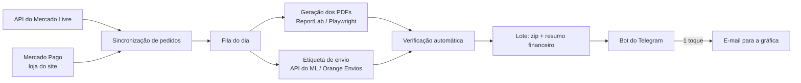

# CogniVita: automação de vendas e produção

Sistema que desenvolvo para a **CogniVita** ([cognivita.com.br](https://cognivita.com.br)), a minha pequena loja de apostilas impressas de estimulação cognitiva para idosos, vendidas no Mercado Livre e no site próprio.

O sistema está em uso real desde 2026. Todo dia ele pega os pedidos pagos, gera os PDFs de cada apostila, emite a etiqueta de envio, confere tudo e monta o lote para a gráfica que imprime e posta.

> Este repositório é uma **vitrine**. O código de produção fica num repositório privado porque tem dados de clientes e credenciais. Aqui ficam a arquitetura, as decisões e o que aprendi no caminho.

## O problema

No começo eu fazia tudo à mão, todo dia: abria cada venda, gerava a apostila certa, baixava a etiqueta, conferia endereço e quantidade e mandava tudo à gráfica por e-mail. Isso levava tempo e dava erro: apostila trocada, etiqueta faltando, pedido esquecido.

## O que o sistema faz

- **Sincronização:** lê os pedidos pagos de duas contas do Mercado Livre (OAuth 2.0 com renovação de token) e da loja do site (Mercado Pago).
- **Produção:** cada anúncio tem no catálogo o que deve ser impresso, e o sistema gera os PDFs com o nome do comprador. Itens do mesmo pacote vão juntos, numa pasta só.
- **Etiquetas:** baixa a etiqueta pela API. Quando a API não emite (primeira etiqueta, que precisa de declaração de conteúdo), um robô de navegador faz o clique no site.
- **Verificação:** antes de liberar o lote, confere páginas, arquivos e etiqueta de cada envio.
- **Lote e financeiro:** gera o zip para a gráfica e uma planilha com receita, tarifas, frete e lucro por pedido.
- **Bot do Telegram:** avisa o resultado do dia e manda o lote à gráfica com um botão. Também lê o orçamento que a gráfica responde e lança como despesa.
- **Rotina diária:** roda sozinho às 10h pelo Agendador de Tarefas do Windows.

## Tecnologias

| Parte | Ferramentas |
|---|---|
| Linguagem principal | Python |
| Banco de dados | PostgreSQL (Neon) em produção, SQLite para testes locais |
| PDFs | ReportLab e Playwright (HTML → PDF) |
| Integrações | API do Mercado Livre, Mercado Pago, Orange Envios, Telegram Bot API, Gmail (SMTP/IMAP) |
| Loja do site | Cloudflare Pages + Functions (JavaScript) |
| Automação de navegador | Playwright |
| Testes | pytest (~460 testes) e testes em JavaScript |
| Versionamento | Git (420+ commits) |

## Decisões que tomei

- **Idempotência:** a rotina pode rodar duas vezes no mesmo dia sem comprar etiqueta duplicada nem lançar venda repetida. Cada pedido é "reservado" antes de ser produzido.
- **Um pedido com problema não para os outros:** cada envio é tratado isolado. O que falha vira aviso no Telegram, e o resto do lote segue.
- **Testes com dependências falsas:** as APIs externas entram por injeção de dependência, então os testes rodam sem internet e sem gastar dinheiro com etiqueta.
- **Preço numa fonte única:** a tabela de produtos é a única fonte de preço. O site nunca confia no valor que vem do navegador.

## O que aprendi (e o que ainda estou aprendendo)

- Integrar APIs reais é bem diferente de ler a documentação. Muitos casos só aparecem em produção: um campo obrigatório que não estava documentado, ou uma transportadora que exige um passo extra para liberar a etiqueta.
- Escrever testes antes de mexer em código que já funciona me salvou várias vezes.
- Ainda quero melhorar a organização do código (algumas partes cresceram rápido demais) e a observabilidade: hoje os logs são arquivos de texto.

## Sobre mim

Leone Assis, estudante de Ciência da Computação na UFSJ (2026–2029).
[LinkedIn](https://www.linkedin.com/in/leoneassis/) · [GitHub](https://github.com/Leonekkj)
